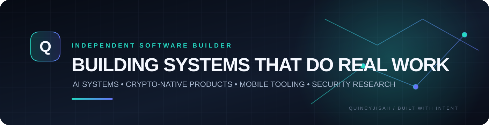

  

## Engineering focus

I build practical software across **AI workflow systems, crypto-native products, mobile tooling and security-minded engineering**. The focus is on working systems, auditable behaviour, explicit release gates and honest separation between prototypes and production software.

## Product portfolio

| Project | What it does | Built for | Verified stage |
|---|---|---|---|
| **Open Velo** · private | Crypto-only ride marketplace concept with wallet-based ride deposits and escrow | Riders, drivers and mobility operators | Ethereum Sepolia prototype; no live rides or real-fund payments |
| **ATLAS** · private | Human-in-the-loop AI operating system with traceable plans, approvals and cost-aware automation | Individuals, founders and small teams | Early product foundation; production integrations and live security checks remain |
| **LeadPilot** · private | Lead inbox, enquiry triage, follow-up prioritisation and response drafting | Freelancers and small service businesses | Local MVP; production authentication and multi-tenant sync remain |
| **FRP Lab** · private | Android diagnostics and authorised device-security research | Device owners, technicians and Android developers | Demo dashboard and limited native diagnostics; device validation remains |
| **iPhone Service Lab** · private | Read-only iPhone diagnostics and evidence-led firmware research | iPhone owners and authorised mobile technicians | Read-only research toolkit; no device modification |
| **LEAP** · private | AI-assisted application-builder concept and product interface | Independent developers and small teams | Frontend concept; AI generation and backend are not connected |
| **FIRE STAR ONLINE** · private/local | Specialist technology marketplace concept with product-provenance and crypto-settlement direction | Specialist hardware buyers and sellers | Preview/development stage; no live listings or payments |
| **X-Market** · private | Crypto-only marketplace concept inspired by large-scale online retail, with a distinct product model | Crypto-native buyers, sellers and independent merchants | Concept/development stage; no live marketplace or payments |
| **Aries Contracts** · private workspace | Escrow, dispute and NFT contracts for a chess-based Web3 game | Web3 game builders and contract engineers | Local tests pass; no production deployment or independent audit |
| **Crypto Blackjack** · local/private | Terminal-first crypto-game experiment | Crypto-game developers and systems tinkerers | Private prototype; no production wagering or payout service |

Private repositories and local prototypes are intentionally not linked. Their inclusion is not a claim that they are production-ready.

## Public repositories

  
  
  

- [Crypto Chess](https://github.com/quincyjisah/CRYPTO-CHESS-USTD) — public concept and prototype documentation for a chess/Web3 project; no live wagers or escrow.
- [Android Manifest](https://github.com/quincyjisah/android_manifest) — historical Havoc-OS Android 10 source manifest for ROM maintainers; not a current Android 16 baseline.
- [Samsung Galaxy A5 2016 device tree](https://github.com/quincyjisah/android_device_samsung_a5xeltexx) — legacy LineageOS 15.1 device tree for SM-A510F, SM-A510M and SM-A510Y variants.

## Engineering principles

- Human approval before external, financial, destructive or customer-facing actions.
- Least privilege, secret hygiene and tenant isolation.
- Automated tests and inspectable evidence before release claims.
- Explicit testnet/mainnet boundaries for crypto systems.
- Privacy-first, read-only diagnostics when inspecting personal devices.
- Clear documentation of implemented features, limitations and release blockers.

## Retired work

**Bolt4Free** is retired and excluded from the active portfolio. Its historical Git revisions may contain obsolete security-research code or identifiers. It is not maintained or supported and should remain isolated pending a private-history and credential review.

---

Independent software projects and research. Product names are working labels unless separately cleared. Status reflects the latest locally verified evidence and can change; consult each repository's README and release gates before use.
